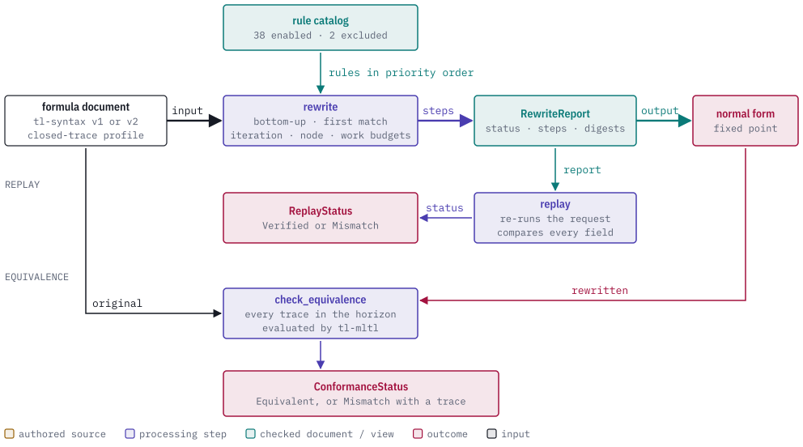
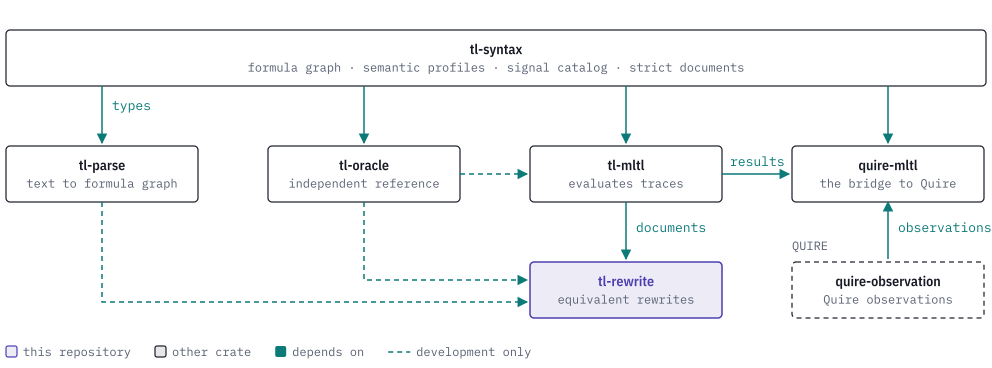

# tl-rewrite

[](https://discord.gg/k8DVhuYBR2)
[](#license)
[](Cargo.toml)

tl-rewrite is a Rust crate that rewrites Mission-time Linear Temporal Logic (MLTL)
formulas into a normal form by applying a fixed catalog of semantics-preserving
rules. It is one of the TL family:
[tl-syntax](https://github.com/agent-ix/tl-syntax),
[tl-parse](https://github.com/agent-ix/tl-parse),
[tl-mltl](https://github.com/agent-ix/tl-mltl),
[tl-oracle](https://github.com/agent-ix/tl-oracle) and
[quire-mltl](https://github.com/agent-ix/quire-mltl).

The crate takes a validated tl-syntax formula document and returns a report with
the rewritten document, the ordered list of rule applications and a digest for
every step. A report can be replayed to confirm that it was produced by this
catalog and these options. A separate comparison enumerates every trace within a
formula's horizon, evaluates both formulas with tl-mltl and returns either
agreement or the first trace on which they differ. The crate does not parse text
and does not evaluate formulas itself.

<picture>
  <source media="(prefers-color-scheme: dark)" srcset="docs/images/hero-dark.svg">
  
</picture>

> **Status: prerelease.** The API is not stable. The crate has `publish = false`
> and other TL crates depend on it through git. Registry publication waits for
> the v0.1 assurance review.

## Usage

This rewrites `not (not (true and p3))`, replays the report and checks the result
against the input. It compiles and runs against the default features.

```rust
use tl_rewrite::{
    check_equivalence, replay, rewrite, ConformanceOptions, ConformanceStatus, ReplayStatus,
    RewriteOptions, RewriteStatus,
};
use tl_syntax::{FormulaDocument, Node, NodeId, NodeKind, PropositionId, SemanticProfile};

let nodes = vec![
    Node::new(NodeKind::True),
    Node::new(NodeKind::Proposition { proposition: PropositionId(3) }),
    Node::new(NodeKind::And { left: NodeId(0), right: NodeId(1) }),
    Node::new(NodeKind::Not { operand: NodeId(2) }),
    Node::new(NodeKind::Not { operand: NodeId(3) }),
];
let input = FormulaDocument::new(SemanticProfile::ClosedTraceV1, NodeId(4), nodes).unwrap();

let report = rewrite(&input, "demo", RewriteOptions::default(), "rev-1");
assert_eq!(report.status, RewriteStatus::Normalized);
let applied: Vec<&str> = report.steps.iter().map(|s| s.rule_id.as_str()).collect();
assert_eq!(applied, ["bool.and.true-left", "bool.not.double"]);
let output = report.output.as_ref().unwrap();
assert_eq!(output.nodes().len(), 1); // the normal form is p3

assert_eq!(replay(&input, &report).status, ReplayStatus::Verified);

let check = check_equivalence(&input, output, "demo", ConformanceOptions::default());
assert_eq!(check.status, ConformanceStatus::Equivalent);
```

The test `primitive_and_nested_derivations_reach_expected_root` in
`tests/rewrite.rs` checks the same kind of nested rule application. More
examples, including budgets, counterexamples and strict report reading, are in
[docs/examples.md](docs/examples.md).

## Reference

| Item | What it does |
| --- | --- |
| `rewrite`, `rewrite_with_context` | Rewrite a closed-trace or origin-history formula document to a fixed point and return a `RewriteReport`. The contextual form also binds the formula to a signal catalog. |
| `replay`, `replay_with_context` | Re-run a report's request and return a `ReplayReport` that is `Verified` or `Mismatch`. |
| `catalog`, `past_catalog`, `infinite_catalog` | The three immutable rule catalogs, each with a version and a SHA-256 digest. |
| `check_equivalence`, `check_equivalence_with_context` | Compare two closed-trace formulas on every trace within the horizon. |
| `check_past_equivalence` | Compare two origin-history formulas at one history and anchor. |
| `rewrite_infinite`, `replay_infinite` | Rewrite and replay infinite-trace formula graphs. |
| `check_infinite_rewrite` | Compare an infinite rewrite on one lasso trace (feature `infinite-trace`). |
| `report::{read, read_with_context}` | Read a canonical report from bytes and replay it before returning it. |

| Catalog | Rules | Enabled | Profile |
| --- | ---: | ---: | --- |
| `catalog()` | 40 | 38 | `mltl.closed-trace/v1` |
| `past_catalog()` | 26 | 26 | `mltl.origin-complete-history/v1` |
| `infinite_catalog()` | 42 | 40 | `mltl.infinite-trace/v1` |

| Feature | Default | Adds |
| --- | ---: | --- |
| none | yes | Rewriting, replay, equivalence checks, and infinite-trace rewriting and replay. |
| `infinite-trace` | no | `check_infinite_rewrite`, which evaluates both graphs with tl-mltl on a lasso trace. |

See [docs/api-reference.md](docs/api-reference.md) and [docs/rules.md](docs/rules.md).

## The TL stack

tl-rewrite depends on tl-syntax for the formula types and on tl-mltl for the
evaluator that its equivalence checks use. tl-oracle and tl-parse are
development-only dependencies used by its tests.

<picture>
  <source media="(prefers-color-scheme: dark)" srcset="docs/images/tl-stack-dark.svg">
  
</picture>

[docs/how-it-works.md](docs/how-it-works.md) shows where each crate sits in the
text-to-outcome pipeline.

## Building and testing

The full local gate is `make guarded-ci`. It runs the checks below and compares
the gates that completed with the declared list.

```sh
make guarded-ci
```

Individual targets:

```sh
make test              # cargo test --all-targets --all-features
make conformance       # replay every catalog rule through the engine and tl-mltl
make counterexamples   # replay the counterexample corpus
make normalization     # sweep a generated formula family
make spec              # validate the spec and the rule derivations with quire
```

The Rust version is pinned in `rust-toolchain.toml` (1.98.1). Hosted CI is
manual-only; the checks run locally. The conformance, counterexample and
normalization targets run the programs in `examples/` and print one JSON row per
case.

## Contributing

Read [CONTRIBUTING.md](CONTRIBUTING.md) and [CLA.md](CLA.md). Work is specified
before it is implemented; see [CLAUDE.md](CLAUDE.md) for the workflow and
commands. The change history is in [CHANGELOG.md](CHANGELOG.md). Agent-assisted
contributions go through the same requirements, testing, provenance and release
review as any other contribution.

## License

Licensed under either of [Apache License, Version 2.0](LICENSE-APACHE) or the
[MIT license](LICENSE-MIT) at your option. The production dependency graph
contains no Quire Observation or other AGPL-3.0-or-later component, direct or
transitive. This crate does not qualify a production monitor, validate a
consuming project, or make a release, accreditation or certification decision.
