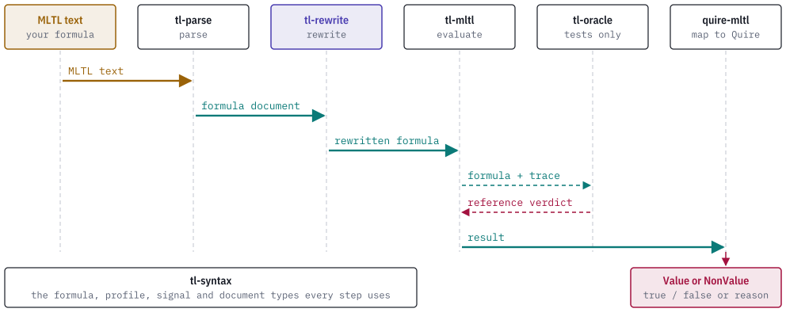

# How it works

## The rewrite engine

`rewrite(input, formula_id, options, source_revision)` takes a `FormulaDocument` from tl-syntax. The document must pass `validate()` and carry the closed-trace or the origin-complete-history profile. A document with any other profile gets the status `UnsupportedProfile`, and an invalid document gets `InvalidInput`. Neither produces an output.

The engine works in passes. In each pass it visits the nodes bottom-up, rebuilds each node from its already-rewritten operands and applies the first rule in the catalog whose precondition matches. Rule order is the catalog order, so the result does not depend on hash order or on the order in which the caller listed the nodes. Identical subtrees are merged into one node, which is how an idempotence rule such as `p and p` can recognize its operands. The engine repeats passes until one changes nothing. That state is a fixed point.

The outcome is one of eight statuses in `RewriteStatus`:

| Status | Meaning |
| --- | --- |
| `Unchanged` | The input was already a fixed point. The report carries the input as its output. |
| `Normalized` | A changed fixed point was reached. An input whose identical subtrees were merged without a rule application also reports this status. |
| `BudgetExhausted` | A configured ceiling stopped the attempt. `exhausted_budget` names it. |
| `NonConvergent` | A complete formula state reappeared before a fixed point. |
| `Failed` | An internal consistency or evaluator failure prevented completion. |
| `InvalidInput` | The document failed structural validation. |
| `UnsupportedProfile` | No enabled rule set exists for the input profile. |
| `UnresolvedBinding` | A contextual request named a proposition that the signal catalog does not bind. |

Only `Unchanged` and `Normalized` carry an output document. Every other status has no output document. It carries a detail string and, when a complete state was reached, a digest of that state.

## Budgets

`RewriteOptions` holds a strategy (`BottomUpFirstMatch`) and four `RewriteBudgets` ceilings. All four are deterministic counts, never wall-clock time.

| Budget | Default | Counts |
| --- | ---: | --- |
| `max_iterations` | 32 | Complete rewrite passes. |
| `max_nodes` | 100,000 | Nodes in any rebuilt candidate graph. |
| `max_rule_applications` | 100,000 | Output-changing rule applications. |
| `max_work_units` | 1,000,000 | Node visits and emissions. |

The options are part of the request digest, so a replay uses the same ceilings.

## Reports

A `RewriteReport` records everything needed to repeat and check the attempt: the caller's formula identity, the engine source revision the caller supplied, the catalog digest, the input digest, a request digest over all of them, the options, the counters, and the ordered `steps`. Each `RewriteStep` names the rule and its revision, the node it fired on, the source span of that node when the input had one, a digest of the node before and after, and a rolling digest over every earlier step.

Rewrites keep the input's schema edition, semantic profile, caller formula identity and source revision. Source spans on nodes that survive are kept.

`rewrite_with_context` adds a `SignalCatalogDocument` and an optional `RequirementContextDocument`. It checks before and after rewriting that every proposition in the formula has a binding. The report then uses the `tl-rewrite.report/v2` schema and records the catalog digest and the context. A missing binding gives `UnresolvedBinding` with a `BindingFailure` that names the proposition and whether the input or the output failed the check.

## Profiles

| Profile | Entry point | Catalog |
| --- | --- | --- |
| `mltl.closed-trace/v1` | `rewrite` | `catalog()` |
| `mltl.origin-complete-history/v1` | `rewrite` | `past_catalog()` |
| `mltl.infinite-trace/v1` | `rewrite_infinite` | `infinite_catalog()` |

`rewrite` picks the catalog from the document's profile. The online-prefix profile is refused: its results can stay pending, and no population of prefix-equivalence evidence has been retained for it. `rewrite_infinite` takes a tl-syntax unbounded formula document, an optional fairness-premises document and a report byte ceiling. It remaps the ordered fairness roots to the rewritten graph and exposes no output unless it reaches a fixed point. The rule families are in [rules.md](rules.md).

## Semantics of the supported finite profile

The closed-trace profile pads missing proposition observations with false, and Boolean constants hold at every queried instant, including after the last observation. As a result `F[a,b] true` is true and `G[a,b] false` is false even on traces shorter than `a + 1`. This differs from textbook finite-trace conventions that require the lower-bound instant to exist. Equivalence claims cover the declared profile and the horizon-complete domain only. [replay-and-evidence.md](replay-and-evidence.md) defines that domain.

## Where the crate sits

A formula passes through several crates on its way from text to a Quire outcome. tl-rewrite is the step between parsing and evaluation.

<picture>
  <source media="(prefers-color-scheme: dark)" srcset="images/pipeline-dark.svg">
  
</picture>

The calling program moves documents from one stage to the next. The dependency structure between the crates is in the [README](../README.md#the-tl-stack).

## In a debugging session

The TL crates answer one question each when a requirement fails on a recorded trace. This page covers step 3 of that walkthrough, normalization. The walkthrough follows the requirement `F[0,3] p2` over a four-instant trace from the retained R2U2 case `r2u2-future-deadline-v1`. tl-rewrite receives the formula document from tl-parse and tl-syntax, and returns a rewritten document with a record of each rule that fired.

<picture>
  <source media="(prefers-color-scheme: dark)" srcset="images/scenario-sequence-dark.svg">
  
</picture>

### What to look for at this step

Read the report `status` first. For this requirement it is `Unchanged` under the closed-trace profile, with no steps, so the formula that tl-mltl evaluates is the formula that tl-parse produced. Under the online-prefix profile, the profile the R2U2 adapter requires, the status is `UnsupportedProfile`, because the engine has no rule set for that profile. Step 3 contributes nothing to the failure in either case.

The program below runs the engine on the requirement. Save it as a file in `examples/` of this repository and run it with `cargo run --example <name>`. It also runs a second formula, `F[0,0] p0`, which is not part of the walkthrough. That formula contains a rule from the catalog, and the output shows what a report looks like when a rule fires.

```rust
use tl_parse::{parse, ParseLimits};
use tl_rewrite::{check_equivalence, replay, rewrite, ConformanceOptions, RewriteOptions};
use tl_syntax::SemanticProfile;

fn main() {
    for (text, profile) in [
        ("F[0,3] p2", SemanticProfile::OnlinePrefixV1),
        ("F[0,3] p2", SemanticProfile::ClosedTraceV1),
        ("F[0,0] p0", SemanticProfile::ClosedTraceV1),
    ] {
        let doc = parse(text, profile, ParseLimits::default()).document.unwrap();
        let r = rewrite(&doc, "demo", RewriteOptions::default(), "walkthrough");
        println!("{text} under {profile:?}: {:?}, {} steps", r.status, r.steps.len());
        for s in &r.steps {
            println!("  step {}: rule {} rev {} on node {}", s.sequence, s.rule_id, s.rule_revision, s.source_node);
        }
        if let Some(out) = &r.output {
            println!("  output nodes: {}", serde_json::to_string(&out.nodes()).unwrap());
            if !r.steps.is_empty() {
                let rep = replay(&doc, &r);
                println!("  replay: {:?}", rep.status);
                let eq = check_equivalence(&doc, out, "demo", ConformanceOptions::default());
                println!("  equivalence: {:?}, horizon {:?}, trace length {:?}, {} of {:?} traces", eq.status, eq.horizon, eq.trace_length, eq.traces_checked, eq.total_traces);
            }
        }
    }
}
```

The output:

```text
F[0,3] p2 under OnlinePrefixV1: UnsupportedProfile, 0 steps
F[0,3] p2 under ClosedTraceV1: Unchanged, 0 steps
  output nodes: [{"kind":"proposition","proposition":2,"span":{"start":7,"end":9}},{"kind":"future","interval":{"start":0,"end":3},"operand":0,"span":{"start":0,"end":9}}]
F[0,0] p0 under ClosedTraceV1: Normalized, 1 steps
  step 0: rule temporal.future.singleton rev 1 on node 1
  output nodes: [{"kind":"proposition","proposition":0,"span":{"start":7,"end":9}}]
  replay: Verified
  equivalence: Equivalent, horizon Some(0), trace length Some(1), 2 of Some(2) traces
```

The first two lines are the requirement from the walkthrough. The output of the `Unchanged` run has the same two nodes as the parsed document: proposition 2 and a `future` node with interval `[0,3]`.

The last four lines are another formula. `F[0,0] p0` is a deadline with a zero-width window, and the catalog rule `temporal.future.singleton` replaces it with `p0`. The report names the rule and its revision and the node it fired on. `replay` re-runs the request and returns `Verified`, which shows the report is the result of this input and these options. `check_equivalence` evaluates the original and the rewritten formula on every trace of the bounded domain with tl-mltl and reports `Equivalent`: horizon 0, traces of one instant, and both of the 2 possible traces agree. The same rule is one case in `corpus/rules/manifest.json`, and `cargo run --example rule_conformance -- --manifest corpus/rules/manifest.json` reports that case as `pass`. Of its 40 rows, 38 are `pass` and the 2 excluded rules are `unsupported`. That agreement covers this domain and does not prove the rule for every formula.

If a verdict changes after normalization, a step in the report has the `rule_id` that did it, and `check_equivalence` returns the first trace on which the two formulas differ. For `F[0,3] p2` there is no step to inspect.

What was run and what was described: the program above, saved as a temporary example, and the `rule_conformance` example were run on this repository, and the output is pasted from those runs. The remaining steps of the walkthrough were not run here. They are in the [walkthrough in tl-mltl](https://github.com/agent-ix/tl-mltl/blob/main/docs/scenario.md).
