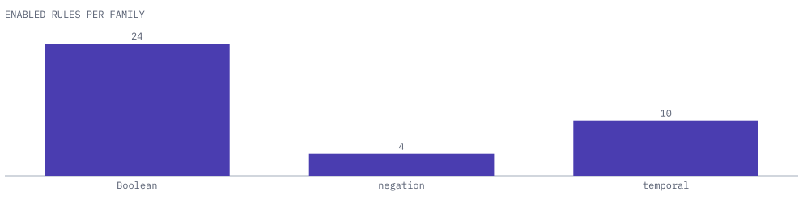

# Rules

The crate ships three immutable catalogs. Each is a `CatalogDocument` with a schema version, a catalog version, a SHA-256 digest over the ordered rules, and the rules in priority order. The engine applies the first matching rule, so the order is part of the catalog's identity and a report records the digest.

Each `RuleDefinition` has a stable `id`, a `revision`, a `RuleClass`, a `RuleDisposition`, the semantic profiles it supports, a `precondition` and a `Provenance` that cites the derivation or primary source. The rule derivations in [DER-001-rule-derivations.md](DER-001-rule-derivations.md) give the argument for each rule in the future catalog.

| Class | Meaning |
| --- | --- |
| `Normalization` | Rewrites to a canonical operator vocabulary. |
| `Simplification` | Removes a redundant construct. |
| `Negation` | Pushes a negation through a dual. |
| `Temporal` | Re-expresses a bounded temporal operator. |

| Catalog | Catalog version | Schema version |
| --- | --- | --- |
| `catalog()` | `tl-rewrite-rules/v1` | `tl-rewrite.catalog/v1` |
| `past_catalog()` | `tl-rewrite-past-rules/v1` | `tl-rewrite.past-catalog/v1` |
| `infinite_catalog()` | `tl-rewrite-infinite-rules/v1` | `tl-rewrite.infinite-catalog/v1` |

## Future catalog

The future catalog has 40 entries and enables 38 of them for `mltl.closed-trace/v1`. Rule identifiers start with the family name.

<picture>
  <source media="(prefers-color-scheme: dark)" srcset="images/rules-dark.svg">
  
</picture>

| Family | Enabled | Rules |
| --- | ---: | --- |
| `bool.*` | 24 | Constant elimination for `not`, `and`, `or`, `implies` and `equivalent`, idempotence of `and` and `or`, double-negation elimination, reflexive `implies` and `equivalent`, `p implies false` to `not p`, and `p implies q` to `not p or q`. |
| `neg.*` | 4 | `not F[a,b] p` to `G[a,b] not p`, `not G[a,b] p` to `F[a,b] not p`, `not (p U[a,b] q)` to `(not p) R[a,b] (not q)`, and the reverse for `R`. |
| `temporal.*` | 10 | Singleton `[0,0]` intervals reduce `F`, `G`, `U` and `R` to their operand. `F` and `G` over a constant become a constant. `true U[a,b] q` becomes `F[a,b] q` and `false R[a,b] q` becomes `G[a,b] q`. |
| `west.*` | 0 (2 excluded) | `west.nested-until-right` and `west.nested-release-right`. |

No distributive or absorption rule is enabled.

The two `west.*` entries come from Theorem 3 of the WEST paper. They split `p U[a,b+c] q` into a nested `U`, and the matching rule does the same for `R`. They are in the catalog with provenance and an `exclusion_reason`, and the engine does not run them, because the interval decomposition policy and a worst-case graph-growth bound have not been approved. The rule conformance run reports them as `unsupported`.

## Past catalog

The past catalog has 26 enabled rules for `mltl.origin-complete-history/v1`. It reuses the 24 `bool.*` rules unchanged apart from the profile they name, and adds two folds that the tl-syntax past-operator definitions state:

| Rule | Rewrite |
| --- | --- |
| `past.once.strong-previous` | `O[1,1] p` to strong Previous. |
| `past.triggered.fold-dual` | `not ((not p) S[a,b] (not q))` to the primitive Triggered node. |

Past-time operators other than these two patterns are left as they are. The past catalog needs a `new_v2` formula document, because past nodes exist only in the v2 edition.

## Infinite catalog

The infinite catalog has 42 entries and enables 40 for `mltl.infinite-trace/v1`. It holds the 24 Boolean rules, the 4 negation rules, the 10 temporal rules and the two past folds, each re-stated for infinite traces with intervals that may be open at the top. The two `west.*` entries are excluded here too. Its rules are valid for every common complete refinement of partial evidence, so they can be applied to formulas whose trace evidence is partial.

## Rule identity

A step in a report names a rule by `id` and `revision`. A change to a rule's meaning or precondition raises its revision and changes the catalog digest, and a replay against an older report then reports `Mismatch`. The rule conformance corpus has one case per future-catalog rule; see [replay-and-evidence.md](replay-and-evidence.md#corpora).
